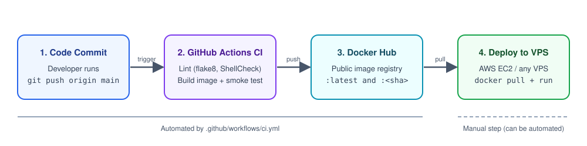

# DevOps Intern Task

A small Flask service, containerized with Docker, built and published by a GitHub Actions pipeline, plus a Bash script that logs basic server health.

`GET /` returns:

```json
{"message": "Hello from DevOps Intern Task!", "status": "running"}
```

## Repository structure

```
.
├── app/
│   ├── main.py                 # Flask app (single "/" endpoint)
│   └── requirements.txt        # Pinned dependencies
├── docs/
│   └── workflow.svg            # CI/CD diagram
├── .github/workflows/ci.yml    # GitHub Actions pipeline
├── Dockerfile                  # Multi-stage, non-root image
├── docker-compose.yml          # Local run on port 8080
├── system_health.sh            # CPU / memory / disk logger
└── README.md
```

## 1. Run the app with Docker Compose

Prerequisite: Docker with the Compose plugin.

```bash
docker-compose up --build        # or: docker compose up --build
```

In another terminal:

```bash
curl http://localhost:8080/
# {"message":"Hello from DevOps Intern Task!","status":"running"}
```

Stop it with `Ctrl+C`, then `docker-compose down`. Add `-d` to `up` to run in the background.

### Docker design choices

- **Multi-stage build:** dependencies are installed in a `builder` stage and only the resulting virtualenv is copied into the final image, so no build leftovers ship.
- **Slim base image:** `python:3.12-slim`.
- **Layer caching:** `requirements.txt` is copied and installed before the app code, so code changes do not reinstall dependencies.
- **Non-root:** the process runs as an unprivileged user (UID 10001).
- **Production server:** gunicorn, not Flask's development server.
- **Healthcheck:** built into the image, using only the Python standard library.
- **Compose hardening:** read-only root filesystem, all Linux capabilities dropped, `no-new-privileges`, `restart: unless-stopped`.

## 2. Run the health-check script

```bash
chmod +x system_health.sh
./system_health.sh
```

It samples CPU over one second, reads memory and disk usage, prints one timestamped line, and appends it to `health_log.txt` (created next to the script):

```
[2026-11-06 14:30:01] CPU: 4.2% | Memory: 38.7% | Disk (/): 52%
```

If disk usage is above 80%, it also prints and logs:

```
[WARNING] Disk space high!
```

Optional environment variables: `DISK_PATH` (default `/`), `DISK_THRESHOLD` (default `80`), `LOG_FILE`.
To see the warning without filling a disk: `DISK_THRESHOLD=1 ./system_health.sh`.

To run it every 5 minutes with cron (`crontab -e`):

```
*/5 * * * * /full/path/to/system_health.sh >/dev/null 2>&1
```

Requires Linux (reads `/proc`).

## 3. CI pipeline (GitHub Actions)

`.github/workflows/ci.yml` runs on every push to `main`:

1. **Lint:** flake8 (Python), ShellCheck (`system_health.sh`), Hadolint (Dockerfile).
2. **Build:** builds the Docker image to verify it compiles.
3. **Smoke test:** starts the container and checks that `/` returns `"status": "running"`.
4. **Push:** publishes the image to Docker Hub as `:latest` and `:<short-sha>`.

### One-time setup

In the GitHub repo go to **Settings > Secrets and variables > Actions** and add:

| Secret | Value |
| --- | --- |
| `DOCKERHUB_USERNAME` | your Docker Hub username |
| `DOCKERHUB_TOKEN` | a Docker Hub access token (Account Settings > Personal access tokens) |

The image is then available as `docker pull <your-username>/devops-intern-task:latest`.
Make the Docker Hub repository public so reviewers can pull it.

## 4. Workflow diagram



## 5. How would you deploy this container to AWS (EC2 or any VPS)?

- **Provision the host:** launch a small EC2 instance (for example Amazon Linux 2023 or Ubuntu on `t3.micro`) and install Docker. The security group opens ports 80/443 to the world and port 22 only to my own IP; an IAM role is attached instead of storing AWS keys on the box.
- **Run the published image:** the server pulls the image CI already pushed, rather than building anything on the host: `docker run -d --name app --restart unless-stopped -p 80:8080 <user>/devops-intern-task:latest`. For HTTPS I would put Nginx (with Let's Encrypt) or an Application Load Balancer in front and keep port 8080 private.
- **Automate releases:** add a deploy job to the workflow that connects to the instance (SSH with a key stored in GitHub Secrets, or AWS Systems Manager) and runs `docker pull` followed by restarting the container, deploying the immutable `:<sha>` tag so a bad release can be rolled back by redeploying the previous one. If the service grew, I would move to ECS Fargate to avoid managing servers.
